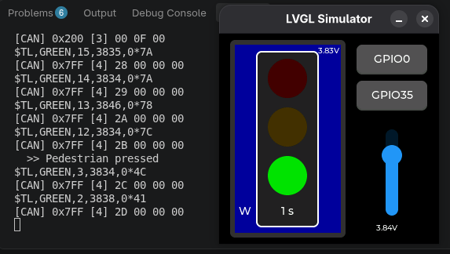
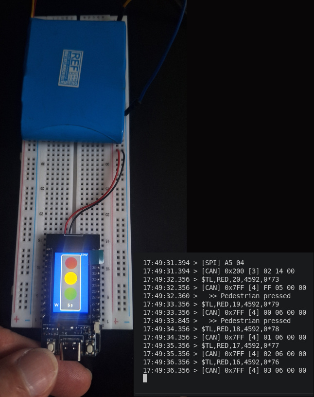
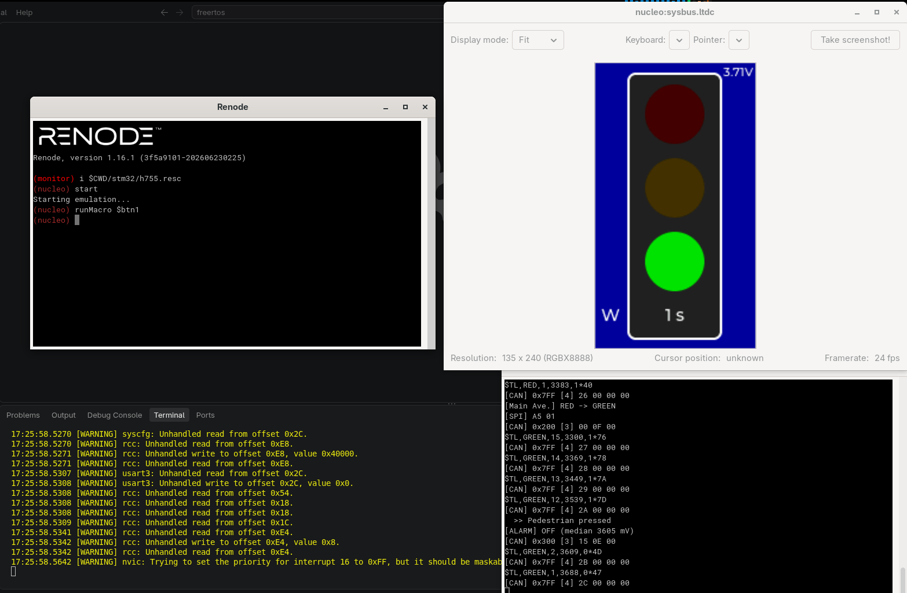

# TrafficLightOnEsp32Stm32LinuxSdl

**v0.2.0**: a traffic light with a pedestrian button, a high-rate signal-processing
pipeline and an LVGL UI. It is built on **FreeRTOS**, and the same application code
(`src/fsm.c`, `src/main.c`) runs on several targets (PC, ESP32, STM32).

It shows all the main FreeRTOS building blocks: **tasks and priorities, queues,
counting semaphore, mutex, recursive mutex, mailboxes, task notifications** and a
**communication gateway task** (UART/SPI/CAN).

| Target | PlatformIO env | FreeRTOS | Display | Signal source |
|---|---|---|---|---|
| Linux PC simulator | `native` | POSIX port | SDL2 window (LVGL) | Slider + random noise |
| LilyGO T-Display (ESP32) | `t-display` | ESP-IDF (SMP) | ST7789 135×240 over SPI | ADC1_CH6 (GPIO34) |
| ESP32-S3 DevKitC | `t-display_s3` | ESP-IDF | — (build only) | — |
| STM32H755 in Renode | `h755_renode` | ARM_CM7 r0p1 port | LTDC framebuffer | Synthetic triangle + noise |
| NUCLEO-H755ZI-Q (CM7) | `h755` | ARM_CM7 r0p1 port | LTDC framebuffer | ADC3 channel 3 |

<table align="center">
  <tr>
    <td align="center"><a href="assets/Linux_SDL_2.png"></a><br>Linux + SDL2</td>
    <td align="center"><a href="assets/ESP32_2.jpg"></a><br>LilyGO T-Display</td>
    <td align="center"><a href="assets/Renode_2.png"></a><br>STM32H755 (Renode)</td>
  </tr>
</table>

## Architecture

```text
 acq (1 ms, prio 5) ── 2 samples/tick = 2 kHz, packets of 50 ms (100 samples)
   │  takes a slot from free_slots (counting semaphore, 4 buffers)
   └─raw_queue(idx)─► dsp (prio 3): median/min/max ─ gives the slot back
                        └─result_queue─► action (prio 2): alarm with hysteresis
                                           ├─ signal_mbox (xQueueOverwrite)
                                           ├─ notify comm (N_ALARM)
                                           └─ ui_queue ─► ui (prio 1) ─ lvgl_mutex
 traffic (1 s, prio 3) ─EV_TICK─┐
 btn (5 ms, prio 4) ─EV_BUTTON──┴► ev_queue ─► fsm (prio 3) ─ traffic_mbox, ui_queue,
                                                             notify comm (N_STATE)
 comm (prio 2): xTaskNotifyWait + 1 s heartbeat ─► UART ($TL), SPI, CAN
 log_mutex: protects printf (mutex with priority inheritance)
```

### Tasks

| Task | Prio | Stack* | Role |
|---|---|---|---|
| `acq` | 5 | 512 | Samples the signal at 2 kHz and fills 50 ms packets |
| `btn` | 4 | 512 | Samples the button every 5 ms + debounce FSM (50 ms) |
| `dsp` | 3 | 1024 | Median/min/max per packet (an FFT would fit here) |
| `fsm` | 3 | 1024 | Only task that touches the traffic light FSM |
| `traffic` | 3 | 512 | Sends `EV_TICK` every 1 s with `vTaskDelayUntil` (no software timer) |
| `comm` | 2 | 1024 | UART/SPI/CAN gateway, woken by notifications |
| `action` | 2 | 512 | Alarm with hysteresis (on < 3.50 V, off > 3.60 V) |
| `ui` | 1 | 1024 | Only task that changes widgets |
| `lvgl` | 1 | 4096 | `lv_timer_handler()` (STM32/simulator; ESP32 uses `esp_lvgl_port`) |

\* In words. `TASK_STACK()` in `platform.h` converts to bytes on ESP-IDF.

### FreeRTOS primitives

- **Queues:** `ev_queue`, `raw_queue` (buffer index only, zero-copy), `result_queue`, `ui_queue`.
- **Mailboxes:** `traffic_mbox` and `signal_mbox` (1 slot, `xQueueOverwrite` + `xQueuePeek`).
- **Counting semaphore:** `free_slots` manages the pool of 4 packet buffers. If `dsp`
  falls behind, `acq` doesn't block. It drops the packet and counts it (`dropped`).
- **Mutex:** `log_mutex` serializes `printf` (priority inheritance).
- **Recursive mutex:** `lvgl_mutex` protects LVGL (on ESP32, `lvgl_port_lock`).
- **Task notifications:** `N_STATE` / `N_ALARM` bits to `comm` (`eSetBits`). The
  notification wait has a timeout, and that timeout drives the 1 s heartbeat.

### Communication

| Bus | Output | Content |
|---|---|---|
| UART | `stdout` (USART3 / UART0 / terminal) | `$TL,<state>,<remaining_s>,<median_mv>,<alarm>*<xor>` every 1 s |
| SPI | stub, hex in the log | `A5 <lamp mask>` on each state change |
| CAN `0x200` | stub, hex in the log | state, remaining s, walk |
| CAN `0x300` | stub, hex in the log | median mV (LE, 2 bytes), alarm |
| CAN `0x7FF` | stub, hex in the log | heartbeat counter, dropped packets |

To use real hardware, replace `bus_spi_send()` / `bus_can_send()` in `main.c`
with TWAI (ESP32) or FDCAN (STM32) calls.

> **Note:** in a real product the acquisition stage (`acq`) could be an external
> chip or co-processor sending raw samples over UART/SPI/I2C/I2S with DMA. The
> end-of-DMA ISR would call `vTaskNotifyGiveFromISR()` (or `xQueueSendFromISR()`)
> and the rest of the pipeline stays the same.

### Traffic light timing (`src/fsm.c`)
| State | Duration | Pedestrian button |
|---|---|---|
| GREEN | 15 s | Shortens the remaining green to 3 s and shows **W** |
| YELLOW | 5 s | Ignored |
| RED | 20 s | Ignored; clears the request when it ends |

## Project layout
```
src/        application, FSMs, platform layer, simulator board (sim_board.c)
sim/        FreeRTOSConfig.h and lv_conf.h for the PC simulator
stm32/      FreeRTOSConfig.h, lv_conf.h, linker script and Renode script (h755.resc)
lib/        FreeRTOS-Kernel (git submodule)
freertos_port.py   selects the FreeRTOS port and heap for native/STM32
lib_FreeRTOS-Kernel_library.json   library.json copied into the submodule
```

## Setup
```bash
git clone --recursive https://github.com/JuniorPolegato/TrafficLightOnEsp32Stm32LinuxSdl
cd TrafficLightOnEsp32Stm32LinuxSdl
# if not cloned with --recursive:
git submodule update --init
# copy the library.json file:
cp lib_FreeRTOS-Kernel_library.json lib/FreeRTOS-Kernel/library.json

pip install platformio
sudo apt install libsdl2-dev        # native simulator
```
Renode: <https://github.com/renode/renode/releases>

To add the kernel to a fresh clone of the project (maintainer only):
```bash
git submodule add https://github.com/FreeRTOS/FreeRTOS-Kernel lib/FreeRTOS-Kernel
cp lib_FreeRTOS-Kernel_library.json lib/FreeRTOS-Kernel/library.json
```

Optional: speed up ESP32 builds with ccache:
```bash
./enable_ccache.sh
```

## Build and run

### PC simulator (Linux + SDL2)
```bash
pio run -e native && .pio/build/native/program
```
| Input | Action |
|---|---|
| `GPIO0` button or `Space` | Pedestrian button |
| `GPIO35` button | Second button (simulated) |
| Vertical slider | Signal base level, 3.00–4.20 V (±40 mV noise + 1% spikes of ±600 mV) |

Move the slider below 3.50 V to see `[ALARM] ON`, the value turning red and a
CAN `0x300` frame. The spikes don't affect the median.

If Wayland causes problems, the simulator sets `SDL_VIDEODRIVER=x11` by default.
Override it with `SDL_VIDEODRIVER=wayland`.

### LilyGO T-Display (ESP32)
```bash
pio run -e t-display -t upload && pio device monitor
```
The pedestrian button is the `BOOT` button (GPIO0). The signal is read on ADC1_CH6
(GPIO34) at 2 kHz through a 2:1 divider, enabled by GPIO14.

### STM32H755 in Renode
```bash
pio run -e h755_renode
renode stm32/h755.resc
(nucleo) start
```
The script loads `.pio/build/h755_renode/firmware.elf` and opens the
USART3 analyzer (115200 8N1, where `printf` output goes). The signal is
synthetic: a 3.3–4.1 V triangle with a 20 s period plus noise, so the alarm
turns on and off by itself.

### Real NUCLEO-H755ZI-Q
```bash
pio run -e h755 -t upload
```
The pedestrian button is the user button B1 (PC13, active high). The signal is
read on ADC3 channel 3 (2:1 divider).

## Expected log
```text
TrafficLight v0.2.0: 2000 Hz, 100-sample packets
$TL,GREEN,14,3902,0*XX
[CAN] 0x7FF [4] 00 00 00 00
  >> Pedestrian pressed
[Main Ave.] GREEN -> YELLOW
[SPI] A5 02
[CAN] 0x200 [3] 01 05 01
[ALARM] ON (median 3480 mV)
[CAN] 0x300 [3] 98 0D 01
```
If the dropped-packet count in `0x7FF` keeps rising, `dsp` can't keep up.

## Sending signals to Renode

```text
# Pedestrian button (B1 / PC13)
(nucleo) sysbus.gpioPortC.UserButton1 Press
(nucleo) sysbus.gpioPortC.UserButton1 Release
(nucleo) runMacro $btn1                      # press + 100 ms + release

# Control and inspection
(nucleo) pause
(nucleo) start
(nucleo) runMacro $reset                     # reload the ELF
(nucleo) showAnalyzer sysbus.usart3
```

You can drive Renode from scripts or another terminal through the monitor port:
```bash
renode --port 1234 stm32/h755.resc
echo "sysbus.gpioPortC.UserButton1 Press" | nc -q1 localhost 1234
```

To debug with GDB:
```text
(nucleo) machine StartGdbServer 3333
```
```bash
arm-none-eabi-gdb .pio/build/h755_renode/firmware.elf -ex "target remote :3333"
```

> **ADC note (real board):** Renode's STM32 ADC model sets only `EOS`, never `EOC`.
> The code uses `EOCSelection = ADC_EOC_SEQ_CONV`, which works in both with a
> single channel. In `h755_renode` the ADC isn't used (synthetic signal).

## Known limitations
- `SystemClock_Config()` doesn't configure the PLL yet, so a real H755 runs on HSI (64 MHz).
- The STM32 display is an LTDC framebuffer only; no panel driver is included.
- SPI and CAN are stubs that print frames in hex.
- Simulator timing isn't real-time. Use it to check logic, not latency.
- Acquisition is paced by the 1 kHz tick (2 samples/tick). For real high-rate
  sampling, use a hardware timer + ADC + DMA.

## Changelog
- **0.2.0:** signal pipeline (`acq` → `dsp` → `action` → `ui`), counting semaphore,
  `log_mutex`, mailboxes, task notifications, `comm` gateway (UART/SPI/CAN).
  The software timer was replaced by `traffic_task`.
- **0.1.0:** traffic light FSM, debounce, queue, software timer, LVGL on three targets.

## License
MIT © Claudio Polegato Junior
