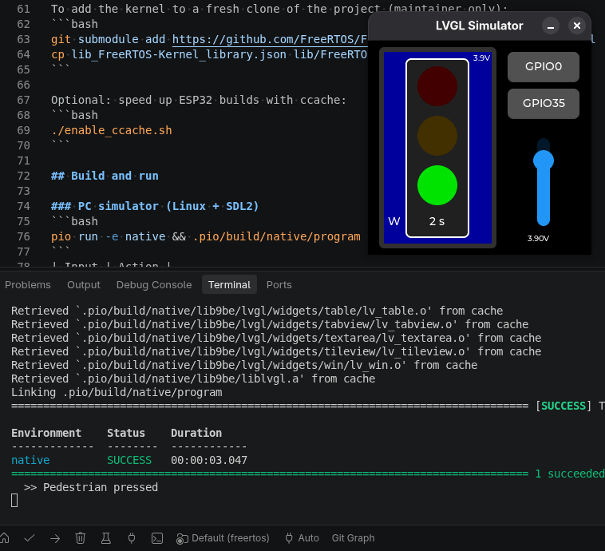
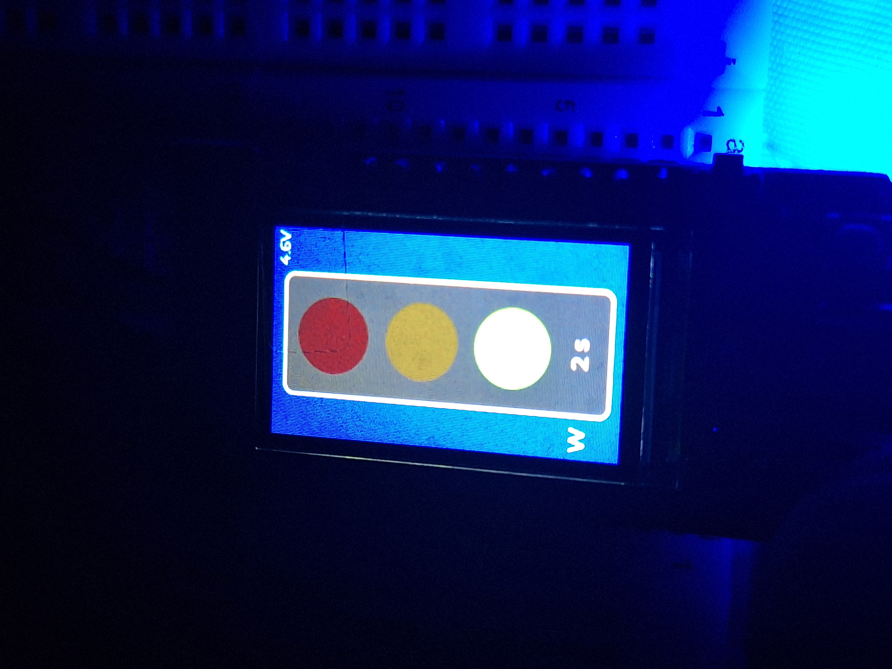
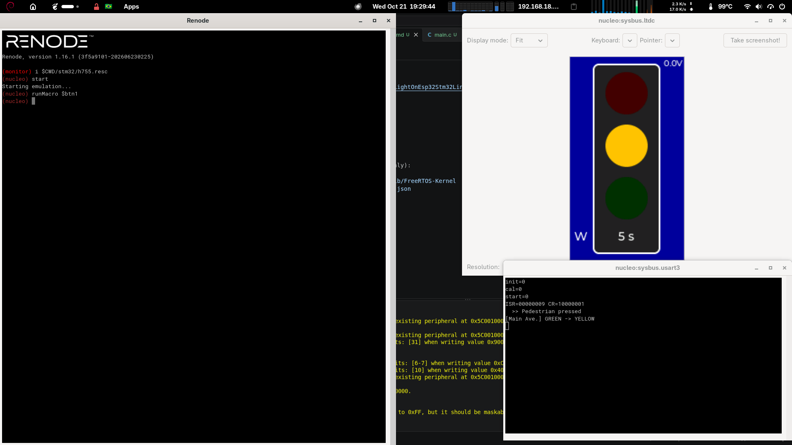

# TrafficLightOnEsp32Stm32LinuxSdl

A traffic light with a pedestrian button, battery monitoring and an LVGL UI.
It is built on **FreeRTOS**, and the same application code (`src/fsm.c`, `src/main.c`)
runs on several targets (PC, ESP32, STM32):

| Target | PlatformIO env | FreeRTOS | Display |
|---|---|---|---|
| Linux PC simulator | `native` | POSIX port | SDL2 window (LVGL) |
| LilyGO T-Display (ESP32) | `t-display` | ESP-IDF (SMP) | ST7789 135×240 over SPI |
| ESP32-S3 DevKitC | `t-display_s3` | ESP-IDF | — (build only)|
| STM32H755 in Renode | `h755_renode` | ARM_CM7 r0p1 port | LTDC framebuffer |
| NUCLEO-H755ZI-Q (CM7) | `h755` | ARM_CM7 r0p1 port | LTDC framebuffer |

<table align="center">
  <tr>
    <td align="center"><a href="assets/Linux_SDL.png"></a><br>Linux + SDL2</td>
    <td align="center"><a href="assets/ESP32.jpg"></a><br>LilyGO T-Display</td>
    <td align="center"><a href="assets/Renode.png"></a><br>STM32H755 (Renode)</td>
  </tr>
</table>

## Architecture

```
 timer "tick" (1 s) ──EV_TICK──┐
                               ▼
 button_task (5 ms, prio 6) ─EV_BUTTON─► ev_queue (10) ─► fsm_task (prio 5)
   └ debounce FSM (50 ms)                                   ├ traffic light FSM
                                                            └ ui_update() ─ lvgl_mutex
 lvgl_task (prio 4) ── lv_timer_handler() ───────────────────┘
```

- **Tasks and priorities:** `btn` (6) samples the button every 5 ms, `fsm` (5) is
  the only task that touches the state machine, and `lvgl` (4) refreshes the screen.
- **Queue:** `ev_queue` carries `EV_TICK` / `EV_BUTTON` events to `fsm_task`.
- **Software timer:** fires `EV_TICK` every 1 s.
- **Recursive mutex:** `lvgl_mutex` protects LVGL calls (on ESP32, `lvgl_port_lock`).
- **Platform layer:** `src/platform.h` provides the button, battery, UI lock and UI root.

### Traffic light timing (`src/fsm.c`)
| State | Duration | Pedestrian button |
|---|---|---|
| GREEN | 15 s | Shortens the remaining green to 3 s and shows **W** |
| YELLOW | 5 s | Ignored |
| RED | 20 s | Ignored; clears the request when it ends |

## Project layout
```
src/        application, FSMs, platform layer, simulator board (sim_board.c)
sim/        FreeRTOSConfig.h and lv_conf.h for the PC simulator
stm32/      FreeRTOSConfig.h, lv_conf.h, linker script and Renode script (h755.resc)
lib/        FreeRTOS-Kernel (git submodule)
freertos_port.py   selects the FreeRTOS port and heap for native/STM32
lib_FreeRTOS-Kernel_library.json   library.json copied into the submodule
```

## Setup
```bash
git clone --recursive https://github.com/JuniorPolegato/TrafficLightOnEsp32Stm32LinuxSdl
cd TrafficLightOnEsp32Stm32LinuxSdl
# if not cloned with --recursive:
git submodule update --init
# copy the library.json file:
cp lib_FreeRTOS-Kernel_library.json lib/FreeRTOS-Kernel/library.json

pip install platformio
sudo apt install libsdl2-dev        # native simulator
```
Renode: <https://github.com/renode/renode/releases>

To add the kernel to a fresh clone of the project (maintainer only):
```bash
git submodule add https://github.com/FreeRTOS/FreeRTOS-Kernel lib/FreeRTOS-Kernel
cp lib_FreeRTOS-Kernel_library.json lib/FreeRTOS-Kernel/library.json
```

Optional: speed up ESP32 builds with ccache:
```bash
./enable_ccache.sh
```

## Build and run

### PC simulator (Linux + SDL2)
```bash
pio run -e native && .pio/build/native/program
```
| Input | Action |
|---|---|
| `GPIO0` button or `Space` | Pedestrian button |
| `GPIO35` button | Second button (simulated) |
| Vertical slider | Battery voltage, 3.00–4.20 V |

If Wayland causes problems, the simulator sets `SDL_VIDEODRIVER=x11` by default.
Override it with `SDL_VIDEODRIVER=wayland`.

### LilyGO T-Display (ESP32)
```bash
pio run -e t-display -t upload && pio device monitor
```
The pedestrian button is the `BOOT` button (GPIO0). Battery is read on ADC1_CH6
(GPIO34) through a 2:1 divider, enabled by GPIO14.

### STM32H755 in Renode
```bash
pio run -e h755_renode
renode stm32/h755.resc
(nucleo) start
```
The script loads `.pio/build/h755_renode/firmware.elf` and opens the
USART3 analyzer (115200 8N1, where `printf` output goes).

### Real NUCLEO-H755ZI-Q
```bash
pio run -e h755 -t upload
```
The pedestrian button is the user button B1 (PC13, active high).

## Sending signals to Renode

Type these commands in the Renode monitor:

```text
# Pedestrian button (B1 / PC13)
(nucleo) sysbus.gpioPortC.UserButton1 Press
(nucleo) sysbus.gpioPortC.UserButton1 Release
(nucleo) runMacro $btn1                      # press + 100 ms + release

# Battery: voltage at the ADC pin in mV (2:1 divider → 1950 mV ≈ 3.9 V)
(nucleo) sysbus.adc3 FeedVoltageSampleToChannel 3 1950 1
(nucleo) sysbus.adc3 SetDefaultValue 1950 3  # value used when no samples are queued

# Control and inspection
(nucleo) pause
(nucleo) start
(nucleo) runMacro $reset                     # reload the ELF
(nucleo) showAnalyzer sysbus.usart3
(nucleo) sysbus LogPeripheralAccess sysbus.adc3 true
```

You can drive Renode from scripts or another terminal through the monitor port:
```bash
renode --port 1234 stm32/h755.resc
echo "sysbus.gpioPortC.UserButton1 Press" | nc -q1 localhost 1234
```

To debug with GDB:
```text
(nucleo) machine StartGdbServer 3333
```
```bash
arm-none-eabi-gdb .pio/build/h755_renode/firmware.elf -ex "target remote :3333"
```

> **ADC note:** Renode's STM32 ADC model sets only `EOS` (end of sequence),
> never `EOC`. The code uses `EOCSelection = ADC_EOC_SEQ_CONV`, which works
> both in Renode and on real hardware with a single channel.

## Known limitations
- `SystemClock_Config()` doesn't configure the PLL yet, so a real H755 runs on HSI (64 MHz).
- The STM32 display is an LTDC framebuffer only; no panel driver is included.
- Simulator timing isn't real-time. Use it to check logic, not latency.

## License
MIT © Claudio Polegato Junior
